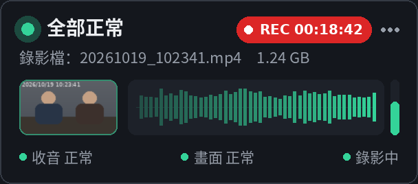

# AudioWatch 筆錄收音監看

製作筆錄時，在螢幕右下角即時顯示 **收音、錄影畫面、錄影狀態**。
收音中斷、畫面全黑、忘了按錄影，當下就會變色提醒。

## 下載

請到 [Releases](../../releases/latest) 下載最新版 `AudioWatch.zip`，解壓縮後執行 `AudioWatch.exe`。
需求：Windows 10／11（不需安裝）。

第一次開啟若出現「Windows 已保護您的電腦」，請點「其他資訊」→「仍要執行」。
官方 SHA256 請見網站或下載包內的 `SHA256.txt`。

## 隱私與安全

不錄音、不錄影、不保存任何聲音或影像、不連網、不需要系統管理員權限。

## 著作權

© 2026 張紘瑋。個人著作，版權所有。歡迎轉傳官方下載連結；未經作者同意，請勿修改或散布修改版本。
問題回報：tcpb0919@gmail.com
